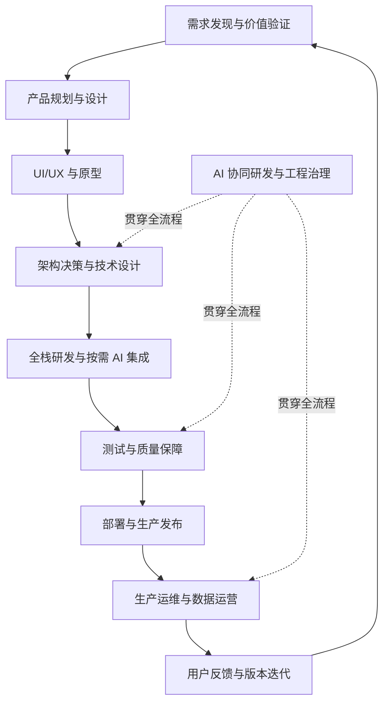

# AI Native Product Engineer｜AI 原生产品工程师

> 本文档用于个人网站的职业定位、专业能力体系与项目案例展示，可作为 AI 优化网站内容时的参考资料。

## 1. 核心职业定位

**AI Native Product Engineer（AI 原生产品工程师）**

以业务价值为导向，以 AI 为核心生产力，具备从需求发现、产品设计、技术研发到生产运营的全生命周期交付能力，并能够对最终产品质量和业务结果负责。

**英文简介**

A product-oriented engineer who leverages AI as a core enabler to deliver software across the entire product lifecycle, from discovery and design to engineering, deployment, and operations, with accountability for product quality and business outcomes.

**核心价值主张**

将真实业务需求转化为可运行、可验证、可维护、可持续演进的软件产品，通过 AI 与软件工程的深度融合，提升产品交付效率、工程质量和业务价值。

不仅关注代码实现，更关注需求是否正确、方案是否合理、交付是否可靠、产品是否创造价值。

## 2. 两条核心能力主线

### Build with AI｜AI 原生软件研发

将 AI 融入业务分析、产品设计、架构决策、软件研发、测试验证、部署运维和持续迭代，建立可复用、可验证、可持续优化的人机协同研发体系。

核心在于通过明确的目标、上下文、工程规范、执行约束和质量门禁组织 AI 参与研发，并由工程师承担最终决策与交付责任。

### Build AI Products｜AI 应用工程

围绕真实业务需求，将大语言模型、多模态模型、RAG、Agent、工具调用和工作流等能力集成到软件产品中，实现具有实际业务价值的 AI 功能，并关注准确性、安全性、稳定性、延迟和成本。

不为使用 AI 而使用 AI，根据业务场景选择传统程序、确定性工作流、LLM 或 Agent 等合适的技术方案。

## 3. 十大核心能力

### 01. 业务理解与商业分析

**Business & Commercial Thinking**

理解业务模式、用户痛点和商业目标，识别真实需求，评估产品价值、实施成本与机会成本，推动技术投入与业务结果保持一致。

- 业务流程、业务规则与业务建模
- 用户需求、使用场景与痛点分析
- 市场调研、竞品分析与需求验证
- 商业模式、投入产出比与优先级决策

**交付价值：** 将模糊的业务构想转化为价值明确、可验证、可执行的产品方向。

### 02. 产品规划与设计

**Product Planning & Design**

将业务需求转化为清晰的产品规格，定义产品目标、功能边界、用户路径和验收标准，控制 MVP 范围并持续规划产品演进。

- 需求分析、PRD 与用户故事
- MVP 定义、功能规划与产品路线图
- 信息架构、业务流程与状态流转
- 产品原型、验收标准与异常场景设计

**交付价值：** 将业务需求转化为研发可执行、测试可验证的产品方案。

### 03. UI/UX 与交互设计

**UI/UX & Interaction Design**

从用户视角优化产品界面与操作流程，兼顾视觉质量、交互一致性、易用性和多端适配，并利用 AI 辅助设计探索与视觉验收。

- 视觉层级、排版、色彩与布局
- 交互流程、操作反馈与状态设计
- 设计系统、组件库与设计规范
- 响应式设计、可访问性与体验优化
- AI 辅助原型、界面生成与设计审查

**交付价值：** 交付清晰、易用、一致且具有良好用户体验的产品界面。

### 04. 系统架构与技术设计

**Software Architecture & Technical Design**

根据业务规模、团队资源和发展阶段进行技术选型与架构决策，在性能、稳定性、扩展性、安全性、成本和交付效率之间取得合理平衡。

- 技术选型、模块划分与系统边界
- 领域建模、数据模型与 API 契约
- 微服务、模块化单体与事件驱动架构
- 数据库、缓存、消息队列与数据一致性
- 高并发、高可用、容量规划与安全架构
- 架构决策记录（ADR）、技术权衡与演进规划

**交付价值：** 建立符合业务发展阶段、能够持续演进且风险可控的技术架构。

### 05. 全栈软件研发

**Full Stack Engineering**

贯通前端、后端、数据库和第三方服务，利用成熟的软件工程方法与 AI 协同能力，将产品规格转化为可运行、可维护的完整软件系统。

- Web 前端、跨端交互与接口集成
- 后端服务、业务逻辑与 API 开发
- 数据库设计、查询优化与事务处理
- 第三方服务集成、异步任务与消息处理
- 代码规范、模块治理、性能优化与安全开发

**交付价值：** 独立或协同团队完成端到端功能研发与软件产品交付。

### 06. 测试与质量保障

**Quality Engineering**

建立客观、可重复执行的质量验证体系，通过自动化测试、代码审查、安全检查和质量门禁控制研发风险，确保人工及 AI 产出的可靠性。

- 测试策略、验收用例与边界条件
- 单元测试、接口测试与集成测试
- 端到端测试、回归测试与性能测试
- 代码审查、静态分析及安全测试
- CI 质量门禁、AI 自动化测试与结果验证

**交付价值：** 以可复查的证据证明产品符合功能、性能、安全及质量要求。

### 07. 部署与生产运维

**DevOps & Site Reliability Engineering**

覆盖软件从构建、发布到生产运行的全过程，通过自动化部署、可观测性、故障治理和成本管理保障系统长期稳定运行。

- Linux、网络、云服务与基础设施
- Docker、容器化与 CI/CD
- 环境管理、数据库迁移、灰度发布与回滚
- Metrics、Logging、Tracing 与告警体系
- 容量规划、SLI/SLO、故障定位与根因分析
- 备份恢复、容灾、稳定性建设与成本优化

**交付价值：** 使产品不仅能够上线，而且能够安全、稳定、可持续地运行。

### 08. 数据运营与产品迭代

**Data Analytics & Product Growth**

以真实用户行为、业务指标和产品反馈为依据评估交付效果，持续识别改进机会，使产品迭代从主观判断转向数据与证据驱动。

- 用户行为埋点与业务事件采集
- 数据统计、分析与可视化
- 活跃度、留存率、转化率与业务指标
- 用户反馈、漏斗分析与实验验证
- 版本迭代、技术债务治理与效果评估

**交付价值：** 建立从产品交付到业务反馈再到持续优化的闭环。

### 09. AI 应用工程

**AI Application Engineering**

将 AI 模型及相关工具能力工程化地嵌入真实产品，构建符合业务目标、可评估、可观测、可控制的智能应用。

- LLM API、流式输出与结构化输出
- Prompt Engineering 与 Context Engineering
- Embedding、向量检索与 RAG
- Function Calling、Tool Calling、MCP 与 Skills
- Agent Loop、任务规划、Memory 与 Workflow
- 多模态应用、人工审批与异常接管
- AI Evals、回归评估、AI 安全与权限控制
- LLMOps、模型路由、延迟及成本管理

**交付价值：** 将模型能力转化为可验证、可维护的业务功能，而非停留在演示原型。

### 10. AI 协同研发与工程治理

**AI Native Software Engineering & Governance**

将 AI 从单点编码助手扩展为贯穿软件生命周期的协作能力，通过规格、上下文、工具环境、执行约束和反馈机制建立可靠的人机协同工程体系。

- AI Coding 与 Agent Coding
- Spec-driven Development（规格驱动研发）
- Context Engineering 与 Harness Engineering
- Agent 任务分解、协作与执行编排
- AGENTS.md、Rules、Skills 与项目知识库
- AI 辅助产品设计、架构评审与研发交付
- 自动化测试、代码审查及 AI 产出验收
- 沙箱、工具权限、敏感信息保护与人工审批
- 可复用研发工作流、工程模板与效能度量

**交付价值：** 建立可复用、可验证、可持续优化的 AI Native 产品研发流程，提升交付效率的同时控制质量与风险。

## 4. 全生命周期交付闭环

AI 协同研发与工程治理贯穿全部生命周期，而非仅在代码开发阶段引入 AI。测试、安全、可观测性和风险管理也应贯穿设计、研发、发布与运营各阶段。

## 5. 工程师与 AI 的职责边界

| 工程师负责 | AI 协助执行 |
| --- | --- |
| 业务价值判断与产品取舍 | 信息检索、需求分析与方案探索 |
| 架构决策、技术选型与风险控制 | 原型、技术方案与代码生成 |
| 任务分解、规范制定与验收标准 | 代码实现、重构与测试执行 |
| 关键实现审查、质量验证与发布审批 | 文档、部署辅助与故障诊断 |
| 最终产品质量和工程交付责任 | 在授权范围内执行任务并反馈证据 |

沟通表达、项目管理、团队协作、系统性思维、技术判断和持续学习是贯穿十大能力的通用基础。

## 6. 个人网站内容应用建议

### 首页／职业定位

**AI Native Product Engineer**

AI 原生产品工程师 · 全生命周期交付 · 软件架构与工程化

以业务价值为导向，以 AI 为核心生产力，贯通需求发现、产品设计、架构决策、研发交付与生产运营，关注产品质量、工程效率与业务结果。

### 专业能力区

建议保留十个能力领域，以简洁的卡片或矩阵进行展示。卡片优先呈现中英文能力名称、一句话能力描述及少量核心标签；详细技术内容可按现有网站信息架构展开，避免首页成为冗长的技能清单。

可使用以下短描述作为卡片内容：

| 能力 | 网站展示短描述 |
| --- | --- |
| 业务与商业分析 | 识别真实需求，评估业务价值与投入产出。 |
| 产品规划与设计 | 从业务构想到产品规格、原型与验收标准。 |
| UI/UX 与交互设计 | 优化视觉质量、操作流程与用户体验。 |
| 系统架构与技术设计 | 权衡复杂度、成本、性能与系统稳定性。 |
| 全栈软件研发 | 贯通前端、后端、数据层与第三方服务。 |
| 测试与质量保障 | 建立自动化验证与可复查的质量门禁。 |
| 部署与生产运维 | 保障软件可靠发布、稳定运行与故障恢复。 |
| 数据运营与产品迭代 | 基于用户反馈和业务数据持续改进产品。 |
| AI 应用工程 | 将 LLM、RAG、Agent 等能力转化为业务功能。 |
| AI 协同研发与治理 | 建立可复用、可验证的人机协同研发流程。 |

### 项目案例区（#work）

以项目事实作为能力证明，而不是单纯罗列技术栈。每个项目建议保留完整项目概要，并根据实际资料补充：

- 业务背景、核心问题与项目目标。
- 本人角色、职责边界和实际贡献。
- 产品范围、关键架构决策与技术方案。
- 研发交付、质量保障与生产运维实践。
- AI 应用或 AI 协同研发实践（仅在实际存在时展示）。
- 可核实的业务成果、工程指标及交付证据。
- 对应的核心能力标签。

可优先映射现有的直播平台、社交平台、电商平台、企业系统等真实项目，以及已有的 AI 产品实践。不要强制每个项目覆盖全部十项能力。

## 7. 给网站优化 AI 的执行约束

1. 将 AI Native Product Engineer 作为长期职业能力建设主线，不替代真实职业经历、历史职务或市场通用岗位名称。
2. 区分能力框架、已有实践、正在建设的能力与未来目标。本文十大能力属于统一职业能力框架，不代表所有能力已经达到专家级或生产级水平。
3. 优先突出已有证据支持的软件架构、全栈研发、技术管理、生产运维和项目交付经验；AI 应用工程及 AI Native 研发治理按实际项目证据展示成熟度。
4. 不编造项目经历、AI 生产落地、业务指标、效率提升比例、能力评级或个人贡献。
5. 历史项目不得被重新包装为 AI Native 项目，除非确有相关实践及证据。
6. 保持现有网站的职业叙事、项目概要、视觉风格和导航逻辑；在扫描实际代码及内容后决定具体修改范围，不进行无关重构。
7. 项目案例遵守保密和脱敏要求，不公开客户敏感数据、内部源码、访问凭证或用户隐私。
8. 中文为主要展示语言，英文用于职业名称、能力名称或必要的辅助说明。

## 8. 核心总结

**以业务价值为目标，以真实项目为载体，以软件工程为基础，以 AI 为核心生产力，以完整交付和可验证成果为能力证明。**

AI Native Product Engineer 不意味着精通所有技术，也不意味着将全部工作交给 AI，而是能够定义正确的问题、选择合适的方案、组织人机协同执行、验证交付结果，并对最终工程质量和业务价值承担责任。
